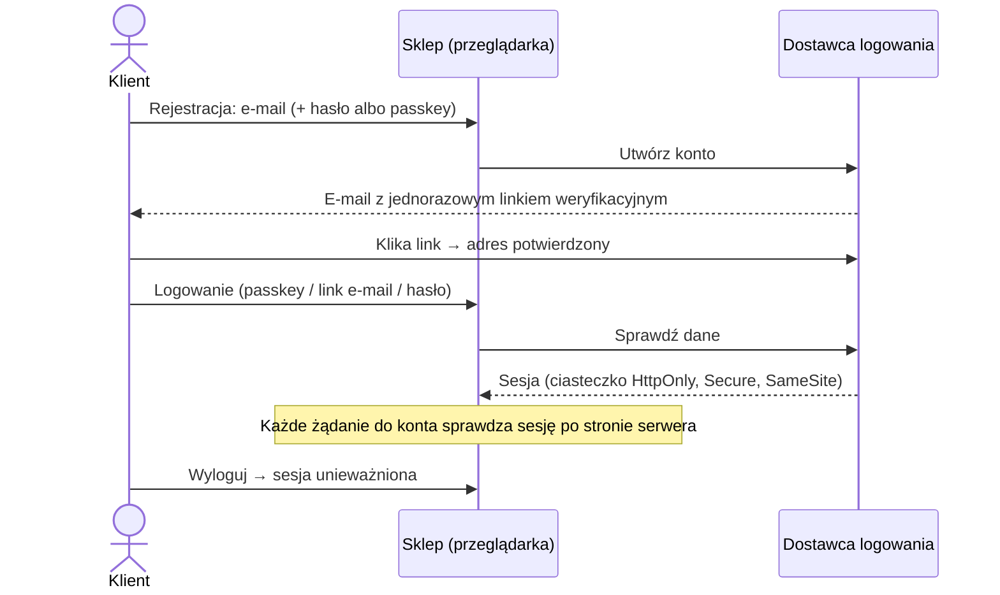
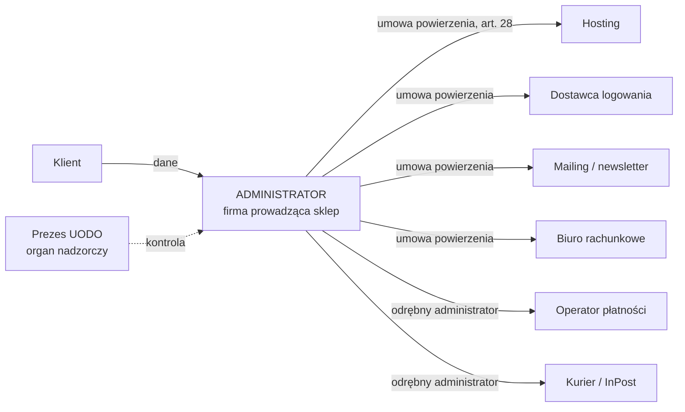

# 04. Logowanie, dane użytkowników, kto jest kim

*Stan na 30.10.2026.*

## W skrócie

- **Demo:** żadnego prawdziwego logowania. „Konto” jest symulacją w przeglądarce i nic nie wysyła. Nie ma więc administratora danych po naszej stronie, a GitHub odpowiada za swoje logi IP.
- **Prawdziwy sklep:** **nie piszemy logowania sami.** Używamy sprawdzonego dostawcy (Supabase Auth w regionie UE, Clerk, Auth0) albo kont wbudowanych w platformę sklepową. Najbezpieczniejsze hasło to takie, którego w ogóle nie przechowujemy: logowanie linkiem e-mail lub passkey.
- **Zakup bez konta** (gość) zawsze możliwy. Konto potrzebne jest tylko do zarządzania subskrypcją, a to może za nas robić portal klienta Stripe.

## Jak działa logowanie (prawdziwy sklep), krok po kroku

## Wymagania bezpieczeństwa logowania

Według OWASP i NIST SP 800-63B-4:

| Obszar | Wymaganie |
|---|---|
| **Weryfikacja e-maila** | Konto aktywne dopiero po kliknięciu jednorazowego linku (ważny krótko, np. 30–60 min) |
| **Hasło (jeśli w ogóle)** | Min. **15 znaków**, gdy hasło jest jedynym zabezpieczeniem (min. 8 przy MFA). Maks. ≥ 64 znaki. **Bez** wymogów „wielka litera + cyfra + znak” i bez wymuszonej zmiany co X dni. Sprawdzanie na liście haseł, które wyciekły |
| **Przechowywanie haseł** | Tylko skrót **Argon2id** (min. 19 MiB pamięci, 2 iteracje) albo bcrypt (koszt ≥ 10) z unikalną solą. Robi to dostawca, nie my |
| **Passkeys (WebAuthn)** | Preferowane: odporne na phishing, bez hasła do zapamiętania |
| **Ochrona przed zgadywaniem** | Limit prób (rate limiting), czasowa blokada, ostrożnie z CAPTCHA (prywatność i dostępność) |
| **Komunikaty błędów** | Zawsze „Nieprawidłowy e-mail lub hasło”. Nie zdradzamy, czy konto istnieje |
| **Sesja** | Ciasteczko `HttpOnly` + `Secure` + `SameSite=Lax`, nowy identyfikator po zalogowaniu, wygasanie po bezczynności. Takie ciasteczko jest **niezbędne**, więc nie wymaga zgody |
| **Reset hasła** | Jednorazowy link z krótkim terminem ważności. Po resecie wylogowanie z innych urządzeń |
| **Panel administratora** | **MFA obowiązkowe**, osobne konto, minimum uprawnień |
| **Logowanie przez Google/Apple** | Wygodne, ale to dodatkowy odbiorca danych. Trzeba to wpisać do polityki prywatności |

## Dostawcy logowania: porównanie

| Dostawca | Region danych | Uwagi |
|---|---|---|
| **Supabase Auth** | Można wybrać **Frankfurt (UE)**; jest umowa DPA | ⚠️ Bezpieczeństwo bazy zależy od **reguł RLS** na każdej tabeli: nowe tabele startują bez nich. Klucz `anon` jest publiczny z założenia. Klucz `service_role` omija wszystkie zabezpieczenia i **nigdy** nie może trafić do przeglądarki ani repo |
| **Clerk** | USA (DPF) | Bardzo prosty, gotowe ekrany logowania |
| **Auth0 (Okta)** | Możliwy tenant w UE | Rozbudowany, droższy przy skali |
| **Firebase Auth** | Google | Wygodny w ekosystemie Google |
| **Konta platformy sklepowej** (Shoper, Shopify) | Według platformy | Najmniej pracy i ryzyka: platforma odpowiada za bezpieczeństwo |

## Jakie dane przetwarza prawdziwy sklep

| Dane | Przykład | Cel | Podstawa (RODO) | Jak długo |
|---|---|---|---|---|
| Konto | e-mail, imię, skrót hasła lub passkey | Logowanie, obsługa konta | umowa (6.1.b) | Do usunięcia konta |
| Dostawa | imię i nazwisko, adres, telefon | Wysyłka | umowa (6.1.b) | Czas realizacji + roszczenia |
| Zamówienia i faktury | produkty, kwoty, daty, NIP | Sprzedaż, podatki | obowiązek prawny (6.1.c) | **5 lat** od końca roku podatkowego |
| Płatności | status, ID transakcji, **nie numer karty** | Rozliczenia | umowa / obowiązek prawny | Jak faktury |
| Subskrypcja | zestaw, częstotliwość, daty | Realizacja subskrypcji | umowa (6.1.b) | Czas trwania + roszczenia |
| Preferencje z ankiety | cel (redukcja/masa), smak, forma | Dobór zestawu | umowa (6.1.b) | Do zmiany lub usunięcia |
| ⚠️ Dane o zdrowiu | choroby, ciąża, leki | **Unikać.** Jeśli konieczne: wyraźna zgoda (art. 9) + DPIA | zgoda wyraźna (9.2.a) | Minimalnie |
| Zgody marketingowe | treść zgody, data, sposób | Newsletter + dowód zgody | zgoda (6.1.a) | Do cofnięcia + okres dowodowy |
| Logi techniczne | IP, przeglądarka, czas | Bezpieczeństwo | uzasadniony interes (6.1.f) | Krótko, np. 30–90 dni |
| Reklamacje, korespondencja | treść, załączniki | Obsługa zgłoszeń | umowa / obowiązek prawny | Do przedawnienia roszczeń |

## Kto jest kim

- **Administrator (ADO):** firma prowadząca sklep. Decyduje o celach i sposobach przetwarzania i odpowiada przed klientem i UODO.
- **Podmioty przetwarzające:** działają na nasze zlecenie, na podstawie umowy powierzenia (art. 28).
- **Odrębni administratorzy:** operator płatności (w części, np. przeciwdziałanie oszustwom), kurier, bank. Przetwarzają dane we własnych celach i na własną odpowiedzialność.
- **Organ nadzorczy:** Prezes UODO (dane osobowe). Przy cookies także Prezes UKE (zob. [02](02-prawo-i-zgodnosc.md)).
- **W wersji pokazowej:** brak danych, więc brak tej układanki. GitHub jako odrębny administrator loguje adresy IP odwiedzających.

## Prawa użytkownika i jak je obsłużyć

| Prawo | Jak w praktyce |
|---|---|
| Dostęp i kopia danych | Przycisk „Pobierz moje dane” albo odpowiedź na e-mail |
| Sprostowanie | Edycja w koncie |
| Usunięcie („bycie zapomnianym”) | Przycisk „Usuń konto”. Faktury zostają, bo wymaga tego prawo podatkowe |
| Sprzeciw / cofnięcie zgody | Link „wypisz się”, ustawienia cookies w stopce |
| Przenoszenie danych | Eksport w formacie maszynowym (JSON/CSV) |
| Termin | Odpowiedź w ciągu **1 miesiąca** |

## Źródła

- [OWASP Password Storage Cheat Sheet](https://cheatsheetseries.owasp.org/cheatsheets/Password_Storage_Cheat_Sheet.html)
- [NIST SP 800-63B-4](https://pages.nist.gov/800-63-4/sp800-63b.html) · [omówienie zmian (Sakimura)](https://www.sakimura.org/en/2025/10/7710/)
- [Supabase: ryzyko braku RLS](https://medium.com/@Gakusen/how-missing-row-level-security-in-supabase-can-expose-user-data-599dcab749f3) · [Supabase a jurysdykcja UE (analiza konkurencji: czytać krytycznie)](https://sota.io/blog/supabase-eu-alternative-gdpr-cloud-act-2026)
- [RODO (EUR-Lex)](https://eur-lex.europa.eu/legal-content/PL/TXT/?uri=CELEX:32016R0679)
