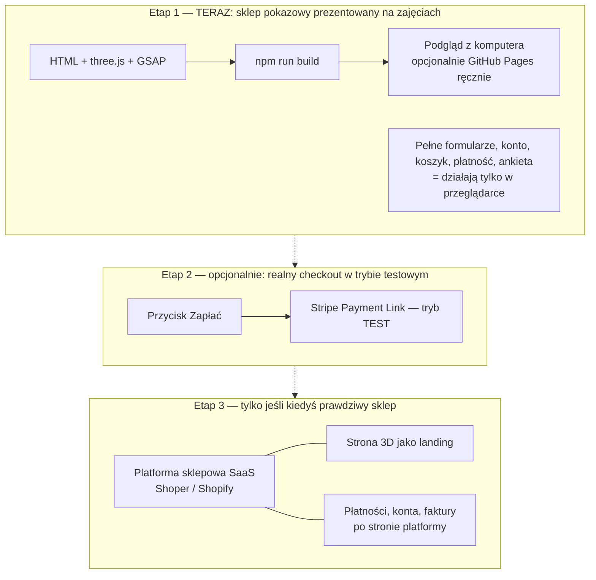

# 06. Architektura i plan

*Stan na 30.10.2026.*

## Decyzja: trzy etapy, robimy tylko pierwszy

| Etap | Co | Kto utrzymuje | Ryzyko |
|---|---|---|---|
| **1. Demo** | Statyczna strona wyglądająca jak kompletny sklep: 3D, produkty, ankieta, konto, koszyk, zamówienie, płatność pokazowa, dokumenty | Nikt: strona po prostu działa | Minimalne |
| **2. Demo + Stripe test** | Jak wyżej + przekierowanie do testowej płatności Stripe | Właściciel konta Stripe | Minimalne (pieniądze testowe) |
| **3. Prawdziwy sklep** | Sprzedaż, konta, subskrypcje, faktury | **Firma + osoba techniczna** | Prawne i techniczne. Zob. [02](02-prawo-i-zgodnosc.md)–[05](05-bezpieczenstwo.md) |

**Dlaczego w etapie 3 platforma SaaS, a nie własny kod:** własny sklep z logowaniem, płatnościami i subskrypcjami wymaga stałego utrzymania: aktualizacji bezpieczeństwa, reakcji na incydenty, zmian prawa. Platforma (np. polski Shoper z gotowymi integracjami BLIK/InPost/KSeF albo Shopify) bierze to na siebie. Własny kod ma sens dopiero z zespołem, który go utrzymuje.

## Stos technologiczny (etap 1)

- **Vite 8**: budowanie i serwer podglądu (`npm run dev`).
- **three.js 0.186**: grafika 3D (WebGL).
- **GSAP 3.15**: animacje i (później) ScrollTrigger do animacji przy przewijaniu.
- **Czysty JavaScript** (moduły ES), bez Reacta: mniej zależności i mniej rzeczy, które mogą się zepsuć.
- **GitHub Actions → GitHub Pages**: tylko ręcznie i opcjonalnie. Strona nie jest publikowana.

## Mapa strony (demo)

**Ustalenie z 30.10.2026:** strona jest tylko pokazowa i prezentowana na zajęciach (nie publikujemy jej), ale ma wyglądać i działać jak **kompletny prawdziwy sklep**. Wszystkie formularze mają komplet pól, a ankieta działa. Szczegóły każdego elementu: [`ZGODNOSC-Z-PRAWEM.md`](../ZGODNOSC-Z-PRAWEM.md).

1. **Strona główna:** hero 3D (kapsułka) + jak to działa w 3 krokach + przykładowe zestawy.
2. **Dobierz zestaw:** **działająca** ankieta o cel i preferencje, bez pytań o zdrowie. Treść opracujemy osobno.
3. **Produkty:** lista + karta produktu z pełną informacją o suplemencie (skład, porcja, ostrzeżenia, dozwolone oświadczenia, opinie).
4. **Subskrypcja:** konfigurator częstotliwości i jasne zasady.
5. **Konto:** rejestracja, logowanie, reset hasła, panel (dane, adresy, zamówienia, subskrypcja, zgody, „Pobierz moje dane”, „Usuń konto”).
6. **Zakup:** koszyk → dane do zamówienia (także bez konta) → podsumowanie z przyciskiem „Zamawiam z obowiązkiem zapłaty” → płatność pokazowa → potwierdzenie.
7. **Po zakupie:** Zwroty (z przyciskiem „Odstąp od umowy tutaj”), Reklamacje, Newsletter.
8. **Dokumenty:** Regulamin, Polityka prywatności, Polityka cookies + baner cookies, Kontakt.
9. **Informacje i prywatność (o demo):** jest.

Zakres produktów zgodny z ustaleniami grupy (BMC). Nie dokładamy nowych funkcji bez decyzji.

## Gdzie to się przyda na praktykach

- **BC5 — makiety (13.11):** działające demo może posłużyć jako prototyp hi-fi albo jego uzupełnienie.
- **BC6 — content/SEO/GEO (20.11):** karty produktów z poprawnymi oświadczeniami, struktura treści, dane strukturalne.
- **Finał (11.12):** link do żywej strony robi wrażenie bardziej niż same slajdy.

## Następne kroki (gdy wrócimy do tematu)

1. Ustalić z grupą: nazwę, kolorystykę i 3 strony-inspiracje, potem napisać `docs/DESIGN.md` (skill frontend-design).
2. ~~Dodać Three.js Resources MCP~~ (✅ podłączony 30.10.2026). Opcjonalnie skille GSAP (zob. [01](01-narzedzia-3d.md)).
3. Zbudować stronę główną i jedną kartę produktu, a potem resztę mapy.
4. Opracować z właścicielem pytania i logikę ankiety.
5. Przed prezentacją przejść [checklistę](checklista-przed-publikacja.md) (część „Wersja pokazowa”).
